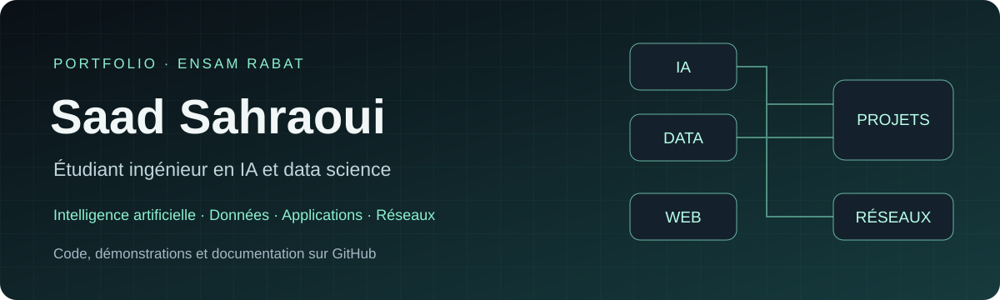
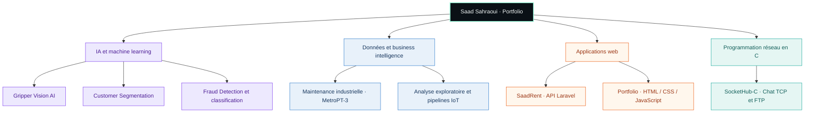
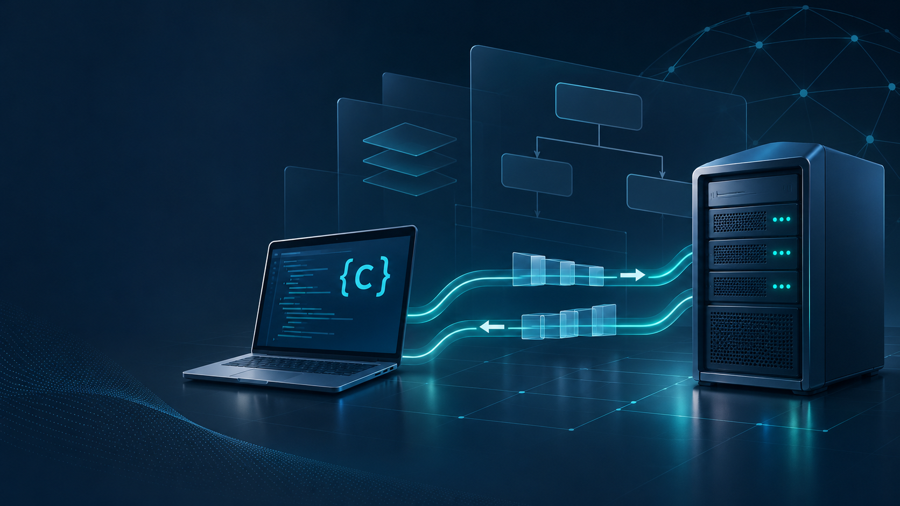
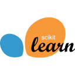
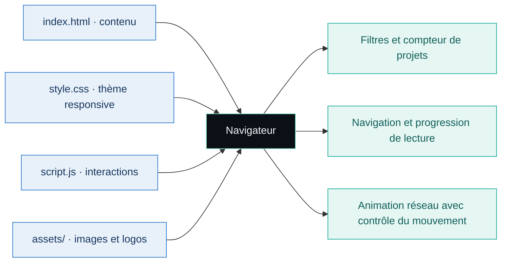

<div align="center">



# Saad Sahraoui · Portfolio

**Étudiant ingénieur en intelligence artificielle et data science · ENSAM Rabat**

Filière INDIA · Ingénierie Numérique en Data Science, Intelligence Artificielle et Santé Digitale<br>
Université Mohammed V de Rabat · Maroc

[](https://saadshr.github.io/)
[](saad_sahraoui_cv.pdf)
[](https://github.com/saadshr)
[](https://www.linkedin.com/in/saad-sahraoui/)
[](mailto:saad20azmm@gmail.com)


[À propos](#à-propos) · [Projets](#panorama-des-projets) · [SocketHub-C](#sockethub-c--programmation-réseau) · [Compétences](#compétences-et-technologies) · [Démarrage](#lancer-le-portfolio-en-local) · [Contact](#me-contacter)

</div>

## À propos

Je suis **Saad Sahraoui**, étudiant en deuxième année du cycle ingénieur à l’**ENSAM Rabat** pour l’année 2026–2027. Ma spécialisation associe data science, intelligence artificielle et santé digitale. Je m’intéresse à la vision industrielle, au machine learning, à la business intelligence, aux pipelines de données et au développement d’applications.

Ce portfolio présente mes projets académiques et mon expérience chez **Eurostyle Systems à Tanger**. Chaque réalisation est accompagnée de ses technologies, d’une description et, lorsqu’il est disponible, d’un accès au code ou à la documentation.

**Objectif professionnel :** contribuer à des projets concrets en IA, data science, machine learning ou développement backend dans le cadre d’un stage PFA ou PFE.

## Explorer le portfolio

- **Profil et parcours :** présentation, formation et expérience en entreprise.
- **Dix projets filtrables :** IA & ML, Données, Web et Réseaux & C.
- **Compétences :** outils utilisés en apprentissage automatique, analyse, data engineering et développement.
- **Contact et CV :** liens professionnels et CV au format PDF.
- **Commentaires privés :** formulaire en bas du portfolio, avec réception par e-mail via FormSubmit.
- **Navigation accessible :** lien d’évitement, focus clavier visible, navigation active et compteur de projets.
- **Interface responsive :** grille adaptée au mobile, progression de lecture et animation réseau désactivable, respectant la préférence de réduction des mouvements.

## Recevoir les commentaires

La section `#commentaires` envoie les messages à **saad20azmm@gmail.com** via [FormSubmit](https://formsubmit.co/). Les commentaires ne sont pas affichés publiquement sur le portfolio. Aucun serveur ni base de données n’est nécessaire dans ce dépôt.

Après publication sur GitHub Pages :

1. Envoyer un premier commentaire depuis le site en ligne.
2. Ouvrir l’e-mail d’activation de FormSubmit reçu à cette adresse (vérifier aussi les spams), puis cliquer sur le lien de confirmation.
3. Envoyer un deuxième commentaire pour vérifier la réception. Le champ e-mail du visiteur permet de lui répondre depuis la messagerie.

Le formulaire utilise une soumission HTML classique et fonctionne sans JavaScript. FormSubmit affiche sa page de confirmation après l’envoi et conserve sa protection reCAPTCHA ; un champ piège complète la protection contre les robots. Les données saisies transitent par ce service externe, comme indiqué à côté du bouton d’envoi.

Pour changer le destinataire, modifier l’adresse dans l’attribut `action` du formulaire dans `index.html`, puis activer la nouvelle adresse. La réception réelle reste à vérifier après déploiement et activation ; un aperçu local ne valide pas la livraison des e-mails.

Documentation : [configuration du formulaire](https://formsubmit.co/documentation) et [activation / problèmes de réception](https://formsubmit.co/help).

## Carte des domaines



Les projets sont regroupés ici par domaine principal. Certains mobilisent plusieurs domaines, notamment l’IoT, le backend et le traitement de données.

## Panorama des projets

| Projet | Domaine | Technologies | Réalisation | Ressources |
| --- | --- | --- | --- | --- |
| **SocketHub-C** | Réseaux et systèmes | C11, WinSock2, GCC, PowerShell, curl | Chat TCP et FTP passif avec quatre exécutables natifs Windows. | [Code][sockethub] · [PDF][sockethub-pdf] |
| **Smart Industrial Maintenance BI** | BI et IoT industriel | Power BI, Power Query (M), DAX, Python, LaTeX | Trois pages d’analyse sur 1 516 948 observations MetroPT-3. | [Code][metropt] · [Rapport][metropt-report] |
| **Gripper Vision AI** | Vision industrielle | Python, OpenCV, scikit-learn, Streamlit | Prototype de recommandation de préhenseur à partir d’une photo. | [Code][gripper] |
| **Customer Segmentation** | Apprentissage non supervisé | Python, pandas, scikit-learn, Jupyter | Comparaison de K-Means, Ward et DBSCAN sur 440 clients. | [Code][segmentation] · [Rapport PDF][segmentation-report] |
| **Smart Fraud Detection** | Machine learning | Python, scikit-learn, XGBoost, FastAPI, Streamlit | Comparaison de modèles sur des transactions déséquilibrées. | [Code][fraud] |
| **Classification ML** | Apprentissage supervisé | Python, scikit-learn, GridSearchCV, Matplotlib | Comparaison et optimisation d’arbres de classification. | [Carte du portfolio][projects] |
| **Analyse exploratoire — EDA** | Analyse de données | pandas, NumPy, Seaborn, Matplotlib | Nettoyage, visualisation et exploration statistique. | [Carte du portfolio][projects] |
| **Système IoT** | Data engineering | Python, Redis, Cassandra | Architecture de traitement de journaux avec cache et persistance. | [Carte du portfolio][projects] |
| **SaadRent** | Backend et API REST | Laravel, PHP, MySQL, JWT | Catalogue de véhicules, réservations et authentification. | [Backend][rental-backend] · [Frontend][rental-frontend] |
| **Portfolio interactif** | Développement web | HTML5, CSS3, JavaScript, Git | Site responsive, filtres de projets et CV téléchargeable. | [Code][portfolio-repo] · [Site][portfolio] |

Les lignes sans lien de dépôt renvoient à leur présentation sur le site.

## SocketHub-C · Programmation réseau



Projet universitaire en **C11 sous Windows**, fondé sur **WinSock2**. Quatre exécutables composent deux services : une messagerie TCP avec accusés de réception et un mini-service FTP avec connexions de contrôle et de données séparées.

- **Chat TCP :** messages cadrés par ligne, gestion des envois partiels et fermeture avec `/quit`.
- **FTP passif :** authentification configurée par variables d’environnement, `LIST`, `STOR` et `RETR`.
- **Gestion des fichiers :** contrôles des chemins sous `ftp_root/` et upload sans écrasement d’une destination existante.
- **Validation :** scripts PowerShell, client C, curl et comparaison SHA-256 des fichiers transférés.

**Périmètre :** démonstration locale sur `127.0.0.1`, sans chiffrement. Le chat traite une session par exécution ; le FTP traite les sessions successivement.


[Voir le dépôt][sockethub] · [Présentation PDF][sockethub-pdf] · [Captures de démonstration][sockethub-screens]

## Autres réalisations à la une

### Smart Industrial Maintenance BI

Projet réalisé à l’ENSAM Rabat avec **Hassan El Hajjam** et **Yassine Saddane**. Un pipeline Python et Power Query (M) prépare les données MetroPT-3 pour un modèle dimensionnel exploité avec DAX dans trois pages Power BI : vue générale, suivi des capteurs et analyse des incidents avec OLAP.

Le jeu de données compte **1 516 948 observations**. Parmi elles, **29 954 (1,97 %)** se situent dans les **quatre périodes d’incident documentées**. Le travail comprend un rapport académique en LaTeX.


-176B53?style=flat-square)


[Voir le projet][metropt] · [Lire le rapport][metropt-report]

### Gripper Vision AI

Prototype développé pendant mon stage d’initiation chez **Eurostyle Systems, à Tanger**. OpenCV segmente une pièce plastique injectée et extrait des caractéristiques géométriques. Une forêt aléatoire propose un type de préhenseur ; l’interface Streamlit affiche la proposition et la segmentation pour le contrôle visuel.


[Consulter le code][gripper]

### Customer Segmentation

Projet réalisé avec **Hassan El Hajjam** dans le module Machine Learning 2. Comparaison de K-Means, Ward et DBSCAN sur les dépenses de **440 clients** du jeu de données UCI Wholesale Customers. La configuration retenue, K-Means à deux groupes, obtient une **silhouette de 0,2903** sur l’ensemble des clients.

   

[Consulter les notebooks][segmentation] · [Lire le rapport PDF][segmentation-report]

### Smart Fraud Detection

Comparaison de la régression logistique, de Random Forest et de XGBoost sur des données de transactions déséquilibrées. Une API FastAPI expose la prédiction et une interface Streamlit permet d’explorer les résultats.


[Voir le projet][fraud]

## Compétences et technologies

### Intelligence artificielle et données

<p>
  &nbsp;
  &nbsp;
  &nbsp;
  &nbsp;
  &nbsp;
  &nbsp;
  &nbsp;
  
</p>

**Python, OpenCV, scikit-learn, pandas, NumPy, Jupyter, Matplotlib et Streamlit.** Préparation de données, apprentissage supervisé et non supervisé, segmentation d’images et interfaces de démonstration.

### Business intelligence et data engineering


**Modélisation dimensionnelle, ETL, mesures DAX, tableaux de bord et stockage SQL/NoSQL.**

### Développement et réseaux


**Applications web, API REST, Git/GitHub, scripts PowerShell et sockets TCP sous WinSock2.**

> [!NOTE]
> Le portfolio lui-même utilise uniquement **HTML, CSS et JavaScript natifs**. Les autres technologies correspondent aux projets présentés.

## Fonctionnement du site



Le site est statique et hébergé sur **GitHub Pages**. Il n’utilise ni backend, ni installation de dépendances, ni étape de compilation.

## Lancer le portfolio en local

Depuis PowerShell, avec Git et Python 3 :

```powershell
git clone https://github.com/saadshr/saadshr.github.io.git
Set-Location saadshr.github.io
python -m http.server 8000 --bind 127.0.0.1
```

Ouvrir [le portfolio local](http://127.0.0.1:8000/). Si le dépôt est déjà cloné, lancer la dernière commande depuis sa racine. Arrêter le serveur avec `Ctrl+C`.

### Modifier le contenu

1. Mettre à jour le profil, les projets ou les liens dans `index.html`.
2. Placer les illustrations dans `assets/` et les référencer avec des chemins relatifs.
3. Pour une nouvelle carte, utiliser une catégorie existante : `ai`, `data`, `web` ou `network`. Le filtre et le compteur sont gérés par `script.js`.
4. Prévisualiser le résultat sur ordinateur et mobile ; vérifier les liens, le clavier et les filtres.

## Structure du dépôt

```text
saadshr.github.io/
├── index.html                    # Profil, parcours, projets, compétences et contact
├── style.css                     # Thème sombre, composants et responsive
├── script.js                     # Filtres, navigation et animation réseau
├── profile.png                   # Portrait
├── saad_sahraoui_cv.pdf           # CV téléchargeable
├── assets/
│   ├── portfolio-banner.svg      # En-tête du README
│   ├── sockethub-network.png     # Illustration de SocketHub-C
│   ├── saad-monogram.svg         # Identité visuelle
│   ├── profile.webp              # Portrait optimisé
│   ├── metropt-overview.webp
│   └── tech/                     # Logos SVG et licence Devicon
└── README.md
```

## Me contacter

**Saad Sahraoui** · Étudiant ingénieur en IA et data science<br>
**Formation :** ENSAM Rabat, Université Mohammed V · **Maroc**

- **E-mail :** [saad20azmm@gmail.com](mailto:saad20azmm@gmail.com)
- **LinkedIn :** [Saad Sahraoui](https://www.linkedin.com/in/saad-sahraoui/)
- **GitHub :** [@saadshr](https://github.com/saadshr)
- **Portfolio :** [saadshr.github.io][portfolio]
- **CV :** [Consulter le document PDF](saad_sahraoui_cv.pdf)

## Crédits visuels

Les logos SVG du dossier [`assets/tech/`](assets/tech/) proviennent de [Devicon](https://github.com/devicons/devicon/tree/v2.16.0), avec leur [licence MIT](assets/tech/LICENSE). D’autres icônes sont servies par Devicon et Skill Icons ; les badges par Shields.io. L’illustration SocketHub-C est reprise des ressources de présentation du [projet réseau][sockethub].

---

<div align="center">

**Des projets documentés, du code consultable et des démonstrations concrètes.**

[Explorer le portfolio][portfolio] · [Consulter mon profil GitHub](https://github.com/saadshr)

</div>

[portfolio]: https://saadshr.github.io/
[portfolio-repo]: https://github.com/saadshr/saadshr.github.io
[projects]: https://saadshr.github.io/#projects
[sockethub]: https://github.com/saadshr/socket-network-programming
[sockethub-pdf]: https://github.com/saadshr/socket-network-programming/blob/main/presentation/output/SocketHub-C_Presentation.pdf
[sockethub-screens]: https://github.com/saadshr/socket-network-programming/tree/main/presentation/assets/screenshots
[metropt]: https://github.com/saadshr/smart-industrial-maintenance-bi
[metropt-report]: https://github.com/saadshr/smart-industrial-maintenance-bi/blob/main/BI_MetroPT_Report/output/BI_MetroPT_Report.pdf
[gripper]: https://github.com/saadshr/gripper-vision-ai
[segmentation]: https://github.com/saadshr/ml2-customer-segmentation
[segmentation-report]: https://github.com/saadshr/ml2-customer-segmentation/blob/main/reports/latex/main.pdf
[fraud]: https://github.com/saadshr/fraud_detection
[rental-backend]: https://github.com/saadshr/carrental-backend
[rental-frontend]: https://github.com/saadshr/carrental-frontend
