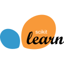

<div align="center">
  
  <h1>Saad Sahraoui · Portfolio</h1>
  <p><strong>Étudiant ingénieur en IA et data science · ENSAM Rabat</strong></p>
  <p>Vision par ordinateur, machine learning et développement web.</p>
  <p>
    <a href="https://saadshr.github.io/"><strong>Voir le portfolio</strong></a> ·
    <a href="saad_sahraoui_cv.pdf">Consulter le CV (PDF)</a> ·
    <a href="https://www.linkedin.com/in/saad-sahraoui/">LinkedIn</a>
  </p>
</div>

## À propos

Je me spécialise en data science, intelligence artificielle et santé digitale à l’ENSAM Rabat, dans la filière INDIA. Ce portfolio rassemble mon parcours, mes compétences et les projets que j’ai réalisés en formation ou en entreprise.

Le site présente **six projets** que l’on peut filtrer par domaine : IA et machine learning, données ou web. La navigation indique la section en cours de lecture et la mise en page s’adapte aux écrans mobiles.

## Projets à la une

### Gripper Vision AI

**Vision par ordinateur · Stage chez Eurostyle Systems, Tanger · 2026**

À partir d’une photo de pièce plastique injectée, OpenCV isole le contour et en extrait les caractéristiques géométriques. Un modèle de forêt aléatoire propose ensuite un type de préhenseur. L’interface Streamlit affiche la recommandation et la segmentation pour permettre un contrôle visuel.

[Voir le code de Gripper Vision AI](https://github.com/saadshr/gripper-vision-ai)

### Customer Segmentation

**Apprentissage non supervisé · ENSAM Rabat · 2026**

Réalisé avec Hassan El Hajjam dans le cadre du module Machine Learning 2. Le projet compare K-Means, la classification hiérarchique de Ward et DBSCAN sur les dépenses de **440 clients** du jeu de données UCI Wholesale Customers. La configuration retenue, K-Means à deux groupes, obtient un **score de silhouette de 0,2903** sur l’ensemble des clients.

[Consulter les notebooks et le rapport](https://github.com/saadshr/ml2-customer-segmentation)

## Technologies

<p>
  &nbsp;
  &nbsp;
  &nbsp;
  &nbsp;
  &nbsp;
  &nbsp;
  &nbsp;
  &nbsp;
  
</p>

- **Projets de données et d’IA :** Python, OpenCV, scikit-learn, pandas et Streamlit.
- **Portfolio :** HTML, CSS et JavaScript natifs, avec Git pour le suivi des versions.

## Lancer le portfolio en local

Aucune installation de dépendances ni étape de compilation n’est nécessaire. Pour prévisualiser le site avec Git et Python 3 :

```powershell
git clone https://github.com/saadshr/saadshr.github.io.git
cd saadshr.github.io
python -m http.server 8000 --bind 127.0.0.1
```

Ouvrir [l’aperçu local](http://127.0.0.1:8000/). Si le dépôt est déjà cloné, lancer uniquement la dernière commande depuis son dossier.

## Structure du dépôt

- [`index.html`](index.html) — profil, compétences, projets et contact.
- [`style.css`](style.css) — thème, mise en page et adaptation aux différentes tailles d’écran.
- [`script.js`](script.js) — filtres de projets, navigation active et progression de lecture.
- [`assets/tech/`](assets/tech/) — logos SVG de [Devicon](https://github.com/devicons/devicon/tree/v2.16.0), sous [licence MIT](assets/tech/LICENSE).

Le portfolio est hébergé sur **GitHub Pages**.
